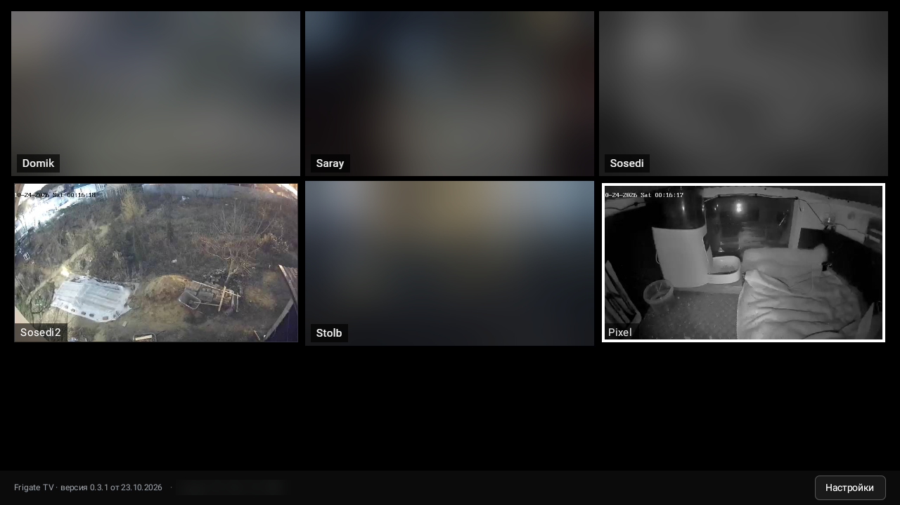
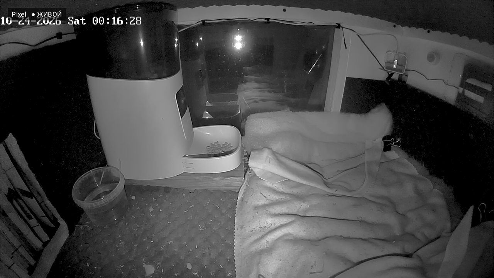
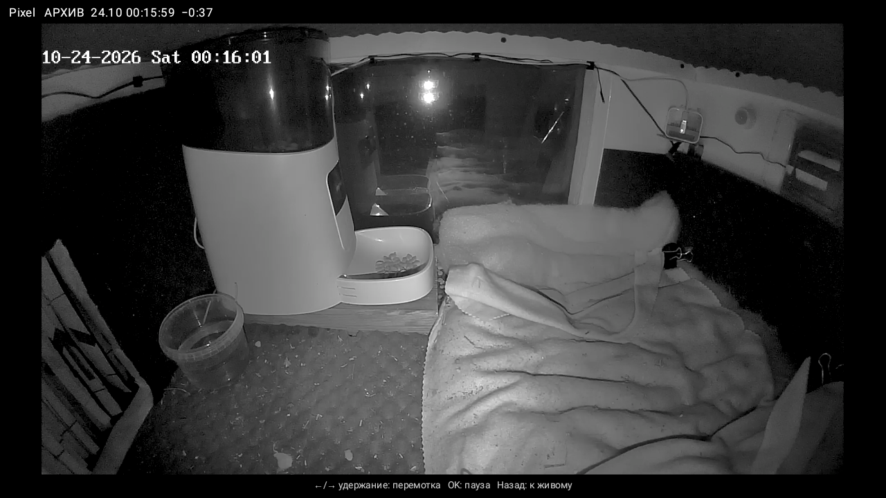
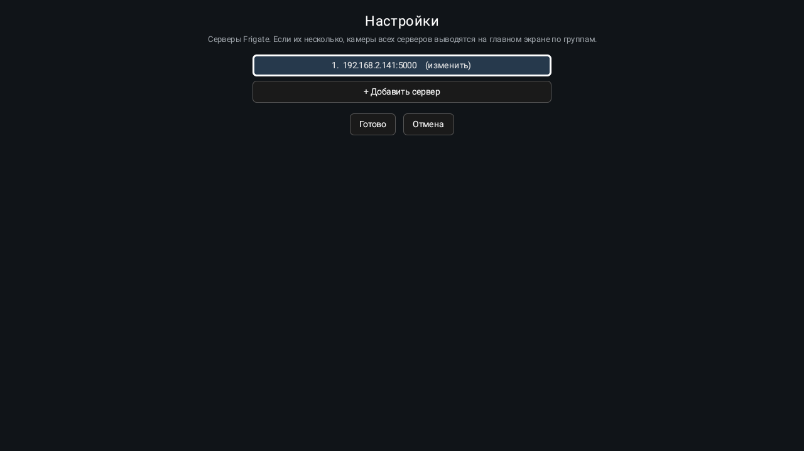
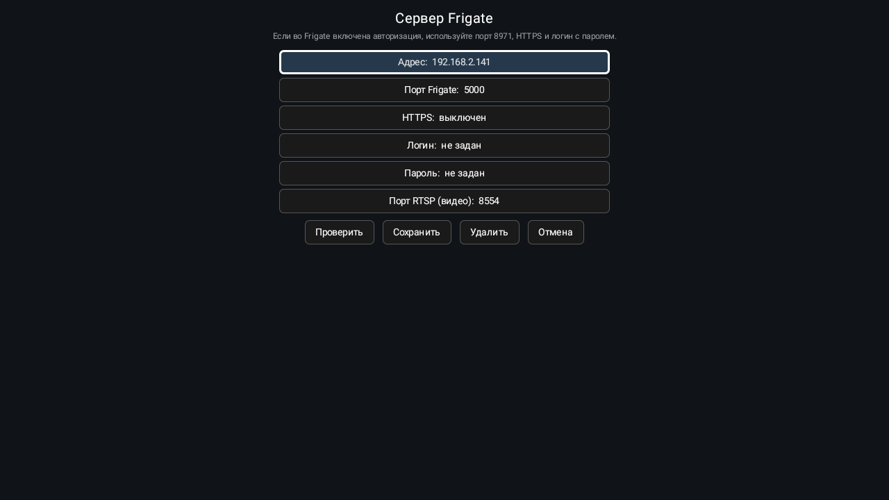

# Frigate TV

**Неофициальный клиент [Frigate NVR](https://frigate.video) для Android TV и приставок.** Сетка камер на большом экране, живое видео почти без задержки и быстрая перемотка архива обычным пультом: достаточно удерживать кнопку ←.

*An unofficial Android TV client for Frigate NVR: camera grid, low-latency live view and fast archive rewind with a plain remote (hold ←). Not affiliated with the Frigate project. English summary at the bottom.*



## Что умеет

- **Сетка камер.** Все включённые камеры сервера на одном экране, снимки обновляются раз в секунду.
- **Живой просмотр** по RTSP через go2rtc из Frigate. Видео стартует меньше чем за секунду, если для камеры заведён отдельный поток `<имя>_live` (см. [советы](#советы-по-настройке-frigate)).
- **Перемотка архива пультом.** Удерживайте **←**, чтобы идти назад: первые 10 секунд по 1 минуте каждые полсекунды, дальше по 30 минут. Удерживайте **→**, чтобы вернуться вперёд. Во время перемотки показываются кадры из записей, после отпускания включается обычное воспроизведение с этого места. **OK** ставит на паузу, **Назад** возвращает к живому видео.
- **Несколько серверов Frigate.** Камеры всех серверов показываются на главном экране по группам, недоступный сервер не мешает остальным.
- **Авторизация.** Нестандартный порт, HTTPS, логин и пароль (порт 8971 с включённой авторизацией Frigate), для самоподписанного сертификата есть переключатель «принимать любой» только для выбранного сервера.
- Управление только пультом, без мыши и сенсорного экрана.

| Живое видео | Архив |
|---|---|
|  |  |

| Настройки | Параметры сервера |
|---|---|
|  |  |

## Установка

1. Скачайте `frigate-tv-<версия>.apk` со страницы [Releases](https://github.com/kisilmike/frigate-tv/releases).
2. Установите на ТВ или приставку: через USB-флешку и файловый менеджер, либо по сети:
   ```bash
   adb connect <IP-телевизора>:5555
   adb install frigate-tv-0.3.1.apk
   ```
   На устройстве нужно разрешить установку из неизвестных источников (для adb: «Отладка по USB/сети» в разделе «Для разработчиков»).
3. Запустите приложение, откройте **Настройки → Добавить сервер** и введите IP-адрес Frigate. Кнопка **Проверить** покажет версию Frigate или причину ошибки.

Требования: Android 8.0 и новее (Android TV, Google TV, Mi Box и т. п.), Frigate 0.17 (на других версиях не проверялось), доступ из локальной сети к портам Frigate (по умолчанию 5000 или 8971) и go2rtc RTSP (8554).

Проверено на Xiaomi Mi Box S (Android 9) и TOX (Android TV).

## Настройка сервера

| Ситуация | Порт | HTTPS | Логин/пароль |
|---|---|---|---|
| Без авторизации (внутренний порт Frigate) | 5000 | выкл. | не нужны |
| Авторизация Frigate включена | 8971 | вкл. | пользователь Frigate (достаточно роли viewer) |

Если Frigate использует самоподписанный сертификат (так по умолчанию), включите «Сертификат: принимать любой» в настройках этого сервера.

## Советы по настройке Frigate

- **Быстрый старт живого видео.** Если камера уже используется во Frigate, её поток в go2rtc общий, и новый зритель ждёт следующий ключевой кадр, иногда 8–16 секунд. Заведите в `go2rtc.streams` второй поток с суффиксом `_live` и тем же источником (например, подпоток камеры). Приложение само найдёт `<поток>_live` и подключится к нему: первый кадр появляется за 0,4–0,8 с.
- **Детекция на подпотоке, запись на основном.** Это снижает нагрузку на процессор, и приложению от этого только лучше.
- **Умное кодирование камер** (H.264+/H.265+ на Hikvision) увеличивает интервал между ключевыми кадрами и задержку старта живого видео, лучше его отключить.

## Сборка из исходников

Нужны JDK 17 и Android SDK (compileSdk 34). Файл `local.properties` с путём `sdk.dir=...` Android Studio создаёт сама.

```bash
./gradlew assembleDebug      # отладочная сборка: app/build/outputs/apk/debug/app-debug.apk
./gradlew assembleRelease    # релизная: подписывается ключом из keystore.properties
```

Для релизной подписи создайте ключ и файл `keystore.properties` в корне проекта (он в `.gitignore`, никогда не коммитьте его и сам ключ):

```properties
storeFile=/путь/к/frigate-tv-release.jks
storePassword=...
keyAlias=frigatetv
keyPassword=...
```

Ключ можно сгенерировать так:

```bash
keytool -genkeypair -keystore frigate-tv-release.jks -alias frigatetv -keyalg RSA -keysize 4096 -validity 36500
```

Без `keystore.properties` релизная сборка получится неподписанной. Стек: Kotlin, Jetpack Compose, Media3 (ExoPlayer RTSP/HLS).

## Как это устроено

- Список камер берётся из `/api/config`, снимки из `/api/<камера>/latest.jpg`.
- Живое видео идёт по RTSP от go2rtc (`rtsp://<сервер>:8554/<поток>`), плеер догоняет край буфера ускорением воспроизведения.
- Архив: во время удержания кнопки показываются кадры из `/api/<камера>/recordings/<время>/snapshot.jpg`, после отпускания загружается HLS-окно `/vod/<камера>/start/<с>/end/<с>/master.m3u8`.
- Логин выполняется через `/api/login`, токен хранится в памяти и обновляется при ответе 401.

## Безопасность

- Адреса, логины и пароли серверов хранятся на устройстве в приватной области приложения **в открытом виде**. Не вводите там пароли, которые используете где-то ещё.
- Режим «принимать любой сертификат» отключает проверку подлинности сервера для выбранного адреса. Используйте только в доверенной домашней сети.
- Приложение не отправляет никаких данных никуда, кроме указанных вами серверов Frigate, и не содержит аналитики.

## Лицензия

[MIT](LICENSE). Проект не связан с авторами Frigate NVR, «Frigate» принадлежит его правообладателям.

## English summary

Frigate TV is a small unofficial Android TV client for [Frigate NVR](https://frigate.video):

- grid of all cameras, updated every second;
- live RTSP view through go2rtc (use a dedicated `<stream>_live` go2rtc stream for sub-second start);
- archive rewind with the remote: hold **←** to rewind (1 min per 0.5 s for the first 10 s, then 30 min steps), hold **→** to go forward, **OK** pauses, **Back** returns to live;
- several Frigate servers grouped on one screen;
- custom port, HTTPS (optionally accepting a self-signed certificate per server), Frigate login/password (port 8971).

Install the APK from [Releases](https://github.com/kisilmike/frigate-tv/releases), open *Settings → Add server* and enter the IP of your Frigate. Requires Android 8.0+. Build with `./gradlew assembleDebug`. The UI is currently in Russian. Licensed under MIT; not affiliated with the Frigate project.
